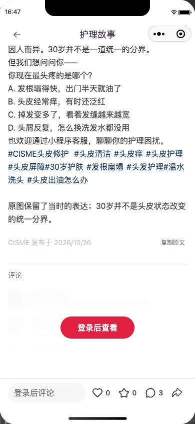
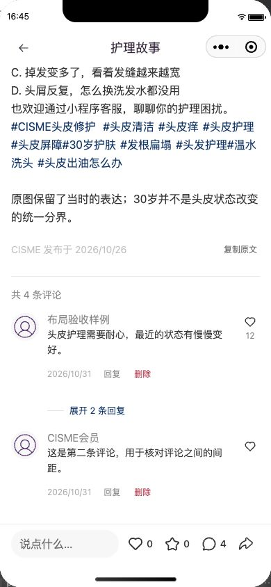

# 评论区、登录与 0.1.16 交付记录

0.1.16 已由官方微信开发者工具上传成功，完成时间为 2026-10-31 23:52:17.922 UTC。对应代码 `de9c85a84faa14931708965e85decee2773475b3`，小程序包源码 SHA-256 为 `5a292ca070e49f25e3284ff3281c7c465ccdd3996adceb8d9700a5280ff02b3e`。编译包为 1,705,097 字节，主包 663,575 字节；只发起一次上传。

隔离体验服务已更新到同一代码，schema103、运行配置、密钥及正式环境均保持原状。现场 HTTPS 核验正文 200、游客评论 401 且没有评论或作者数据。原始 [上传终态](upload-016-official-terminal.json)、[版本绑定](upload-016.json)、[服务更新](server-deployment.json)、[运行核验](server-active.json) 和 [公网读取](public-api.json) 分别保留。

## 原因与修改范围

第一篇帖子的新评论者是另一名有效会员，没有保存过个人资料或头像，资料版本为 0，昵称为初始化默认值。已有资料没有在这条评论中丢失；不能从 `wx.login` 推断真实微信昵称头像，也不能借用管理员的资料补齐。已有会员保存的昵称和头像继续按最新版本读取。登录页删除昵称选填项，新会员由服务端初始化默认昵称，重复登录保留已有资料；设置页仍可主动修改。[只读基线](new-author-db-baseline.json) 仅保存布尔事实，没有会员标识。

排版参考来自[小红书手机 H5](https://www.xiaohongshu.com/discovery/item/6ad9dd17000000002a028060)，使用 Android 身份、390×844 视口实测，未冒称原生 App 验收。H5 的昵称为 15/17px、正文 14/22px、头像约 43.19px、头像文字间距 12px，右侧赞与数量分层排列。CISME 依照微信原生触达要求采用下列规格；[观察记录](reference-observation.json) 分开列出实测值与实现值。

| 项目 | CISME 默认字号规格 |
|---|---|
| 昵称 | 15px / 18px，次于正文的颜色层级，长昵称换行 |
| 评论正文 | 14px / 22px，距昵称 2px，保留用户换行 |
| 日期、回复、删除 | 12px / 18px，日期与操作同行，空间不足时自然换行 |
| 头像与回复 | 根头像 40px、间距 12px；回复缩进 52px、头像 24px |
| 点赞 | 右侧独立列，18px 图标、下方数量，触区至少 44×44px |
| 间距与展开 | 评论上下各 8px；回复默认折叠，展开入口至少 44px 高 |
| 系统大字号 | rem 跟随系统；26 号下昵称实际 24.375px、正文 22.75px |

## 页面与交互

- 游客可读帖子正文；评论区仅绘制装饰占位和渐变模糊玻璃蒙版，按钮为“登录后查看”。没有真实评论藏在蒙版后，也不请求评论列表。接口独立验证有效微信会员身份。点击按钮进入登录页并保留原帖地址；取消登录仍可阅读正文。
- 已登录读取分别呈现加载、无评论、已有评论和失败状态。失败提供重试；翻页失败保留已加载列表和游标。触底与“加载更多评论”使用同一分页读取，不重载正文或改变图片。
- 根评论回复初始全部折叠；“展开 N 条回复”只统计已确认加载的回复。展开后能收起，不虚构尚未读取的回复数量。
- 评论继续直接发表。编辑器显示回复目标，可取消回复、收起并保留输入；网络结果未知时保留原稿和原提交编号，由明确操作核对，不自动重复新建。点赞依据服务端真实回执更新。
- 消费者帖子移除举报、审核及无关管理入口。管理员才显示带颜色的“删除”，点击后确认；服务端再次验证权限，删除根评论后回复和计数按真实可见性收敛。后台历史状态和审计保留。
- 离页、换账号或会话失效后清除私有评论、游标和管理权限；旧账号迟到的结果不能恢复旧资料或清除新账号已确认的列表。评论失效不遮掉仍可公开阅读的帖子正文，也不自动弹出登录页。

## 验证范围

真实游客的蒙版、登录按钮、原帖返回地址及无昵称输入已在原生模拟器重新核验。已登录排版使用临时页面样例验证，未注入会话或写入服务端；375 宽、26 号真实系统字体下核对长昵称、长正文、回复展开／收起和触区，390 宽默认字号核对最小 44px 触达。临时运行状态经完整刷新清除，设备与字体恢复为 390×844、16 号，并通过正常游客读取行为核对。

自动化结果和所有文件摘要见 [source-review.json](source-review.json)。单元测试 2,409 项通过、1 项跳过；最后触区 CSS 修正后补充 28 项定向检查及原生几何检查。评论和资料的隔离数据库检查分别为 38、9 项；部署离线检查 20 项。完整一次性数据库回归 63 个文件、1,050 项全部通过，相关隔离资源已精确清理。旧测试版本边界、资料清单及本地测试时钟差异均已修正，只改测试和文档；[回归记录](regression-summary.json) 保留原失败与最终结果，已上传包不变。远端 CI 跟随 PR 单独运行，本记录不将其进行中状态写成通过。

真机、真实键盘、真实账号本轮完整登录及评论读写／管理员删除尚未实测；合成布局不代替这些验收。AI 回复→申请人工→管理员接待回复→用户读回的真实 DeepSeek 隔离测试沿用[上一轮 API 证据](../comment-support-20261030/live-isolated-e2e.json)，本轮保留相同客服代码与配置，没有新造真实账号聊天事实。全 40 路由状态验收继续标记未完成。
