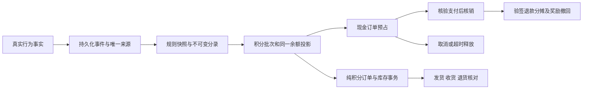

# 会员积分与首次建档交付

业务基线：`docs/product/CISME-产品需求文档-PRD-V2.1-R4.md` §7.9，验收 ID `PTS-CLUB-01–16`。来源为用户提供的两份 Word 文档；文档中的业务描述不视为独立操作授权。本轮用户后续确认覆盖旧“体验版永久关闭”、礼品白名单、硬月预算及纯积分另期的范围判断。

## 已确认口径

| 业务 | 当前规则 |
|---|---|
| 首次建档 | 新账号首次进入护理须完成基础建档；采用第3版设计，含医生推荐、多选及互斥选项。个人情况可跳过，拒绝可选授权仍可完成；首次完成100分，不因注册、手机号或敏感授权另发分 |
| 使用记录 | 如实记录当日产品，净润／净屑／精华可多选；上海自然日首次10分，至少10个非空白字符且至少4种字符的感受额外5分。私人感受加密，不自动公开 |
| 连续奖励 | 每满7天50分、每满30天200分，两者循环叠加；中断重新计数，30天获得徽章 |
| 社区 | 新公开且安全通过的体验笔记50分，每周最多2篇；精选另加100分／篇；有效评论5分，每日最多2条。排除自评及重复内容，删除或下架撤回对应奖励。仅新评论通过真实微信安全后直接发表，历史待审材料不自动公开 |
| 购物 | 现金商品实付净额先取整元，再乘订单商品倍率；已宣传两款保留3倍。确认收货后到账；首笔有效核验支付另加300分。运费、积分抵扣、购物权益不赚购物积分 |
| 生日 | 月日选填、下单前填写，生日当月首单购物积分再乘2；3倍商品合计6倍。300分首购及邀请奖励不翻倍。可随时清除，重复设置受一年防刷事实约束 |
| 邀请 | 先访问邀请链接，再新注册、首购并确认收货，邀请人300分、好友200分。老会员、自荐和重复归因不发。与现金佣金推荐关系独立；问卷勾选“朋友推荐／医生推荐”不会创建推荐收益关系 |
| 使用 | 100积分抵商品价1元。现金订单最高抵商品小计20%，不抵运费，不与佣金购物权益叠加。无额外固定积分使用上限，受真实余额与比例约束 |
| 纯积分 | 全部正常上架、有资质、有效规格的当前及未来商品自动参与，每份默认积分等于售价的“分”。没有礼品白名单或每会员限兑次数；沿用普通单次数量、可售范围及真实库存校验。纯积分订单不创建微信支付、不产生购物奖励和佣金 |
| 有效期 | 每批发放后12个自然月有效，提前30天站内提示，先到期先消耗；不提现、不转让。月度发放额只统计／提醒，不截断应得奖励 |

例：¥298商品的商品现金实付为¥298时，购物积分894；生日当月首单为1788。若使用5960积分抵¥59.60，商品现金实付¥238.40，购物积分714，生日首单1428；首购和邀请按各自独立组件处理。纯积分兑换该规格为29800积分，后续售价变更须重新确认。

连续30天每天获得有效感受额外分的规则演算为 `30×15＋4×50＋200＝850`，不是实际会员经营数据。

## 页面与交互

- 护理：第3版建档组件，医生推荐、最多3项多选、互斥项、断点保存、重放回执与可选授权分开；已存在的会员不补造新注册或历史问卷完成事实。
- 我的：独立积分卡，与积分页读取同一账本。读取失败不显示伪造的0。
- 积分页：赚积分／明细／兑换；可用、冻结、预占、欠分、到期提醒、真实明细总数、游标分页、生日选填、连续记录和徽章。地址或礼品查询慢时不阻塞余额及打卡操作。
- 兑换：选择商品、数量、地址并明确确认，使用服务端价格／规则／地址版本；超时查原命令，未查到不能当作失败。保留原键原载荷重试，切号不能恢复他人兑换；放弃先写服务端 tombstone，阻止晚到请求。
- 积分管理：按真实能力显示兑换履约、商品倍率、未来规则、月度统计、对账差异和精选操作。发货、退货、规则审批独立核权；隐藏或切号后的旧响应不能恢复私人操作状态。
- 点击选项有选中反馈；弹层约180ms进入动画，按钮轻微按压反馈，减少动态效果时关闭。动画不决定保存或兑换成功。

快速产品打卡不生成护理周期完成事实。到期周期仍须明确开始、按00→01→02→03完成并提交自我感受，记录页保留真实步骤；没有使用产品时不引导虚假打卡，不要求每天使用洗发水。

## 资产、订单与异常恢复

- 现金预占、支付核销、取消释放、同一库存和积分批次在事务内互斥。订单锁定规则与商品倍率；后台改倍率不改旧单。
- 纯积分单待发货可取消并返库存；发货后由本人申请退货、授权人员核对实际收货后返原积分。实物退回不自动恢复可售库存。
- 现金退款按累计商品现金退款比例退本单原消费批次，最后全退补足取整差；运费不混入。返还已过期批次给予30天宽限。
- 已花奖励撤回形成欠分，后续所得先冲欠分。仅预占而未支付的失效奖励不提前形成欠分；实际付款才记义务，取消不追缴。退回已撤回奖励时，用关联恢复分录解除债务或恢复已偿还权益，不记作新奖励。
- 数据库唯一来源、不可变分录、批次守恒、命令去重及订单版本共同约束重试；后台定期对账只报告差异，不直接改余额平账。
- 首购不因退款反复重置。邀请双方奖励分别追溯。已过期邀请链接可由新请求更新，同一旧请求仍返回原回执，并发新请求只保留一条活跃链接。
- 新规则须未来生效，由另一名授权人员复核；不能插入到已经公示的未来版本之前。固定100积分抵1元，原积分及订单权益保留，不通过规则更新贬值。

## 数据与接口

新增迁移为 `202611100004_member_care_onboarding.sql`、`202611100005_member_points_club.sql`，排在现有商城111号迁移之后。旧97/111号版本数据均须向前迁移；不得删除积分资产降级。

复用 `points_grant / points_lot / points_entry / points_projection`，补齐不可变交易、规则、使用记录、命令回执、出勤、徽章、生日、首触达邀请、事件、现金消费分摊、纯积分订单／分摊／履约事件及对账记录。问卷答案、私人感受和收货地址加密；本人导出覆盖新增资料，分卷导出同样覆盖。注销／资料删除遵循保全与抑制重放，财务反重和最小必要交易事实独立保留。

主要接线位于 `services/api/src/{careOnboarding,memberPointsClub,pointsLedger,pointsGifts,pointsReconciliation,pointsPrivacy}.ts`、订单／验签支付退款处理、后台 Worker 和原生 `pages/points`、`pages/management-points`；完整接口合同见 OpenAPI。

## 验证与部署状态

实时状态与准确次数见本目录 `verification-summary.json`。签名支付／退款测试使用独立临时 PostgreSQL、对象存储和合成提供方；未执行真实扣款、退款或转账。测试容器已按各次回执移除；没有向真实会员账本写测试奖励或订单。

原生证据按真实源码哈希分开保存：stage1为217edfb4，修订前为04d2856f，最终修订见最新 `current-*`。模拟器合成接口与真实数据库用例是不同证据。旧图不重新标记成当前版本；全41页逐态和iOS／Android真机矩阵不因此自动通过。

2026-11-10只读核对：正式库97号、2会员、0订单／积分分录、3款旧草稿及0库存；隔离体验库111号、7会员、0订单／积分分录，两款真实商品分别¥198／¥298、库存各100，购物和发货真实依赖已启用。不得将体验会员、余额或同一批库存另复制到正式库。后续升级、启用与平台上传必须按实际回执另记，源码完成不视为部署完成。
